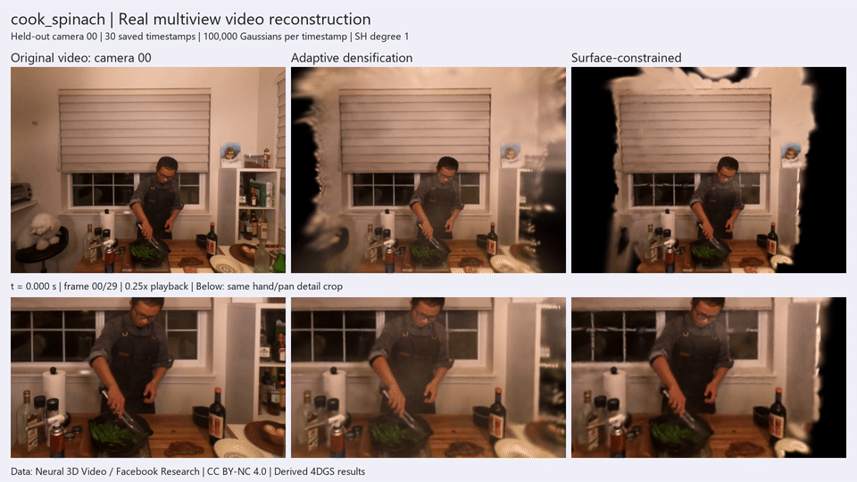

# Photogrammetry-Guided 4D Gaussian Splatting

[English](README.md) | [简体中文](README.zh-CN.md)

A Spyder-friendly implementation for training, inspecting, rendering and evaluating time-varying 3D Gaussian surfaces. The main preview shows results on the public Neural 3D Video `cook_spinach` dataset. The repository also includes self-contained translation and deformation examples with trained models, input images, point clouds and mesh references.



[Original / reconstruction comparison](media/cook_spinach/cook_spinach_comparison.mp4) · [3D Gaussian camera orbit](media/cook_spinach/cook_spinach_3d.mp4) · [Full-resolution preview](media/cook_spinach/poster.png)

## Public Dataset Results

The downloaded [Neural 3D Video dataset](https://github.com/facebookresearch/Neural_3D_Video/releases/tag/v1.0) supplies the real, synchronized multiview `cook_spinach` sequence. The displayed runs use 30 timestamps, 600 training images from cameras 01-20, and 30 held-out camera-00 images. Both models were trained for 6,000 iterations with SH degree 1 and contain 100,000 active Gaussians per timestamp.

The comparison video shows the original held-out images, adaptive densification, and the surface-constrained variant. A fixed detail crop enlarges the hand and pan below each full image. The 3D video separately shows time playback, a camera orbit at fixed scene time, and combined camera/time motion. Both videos use the saved trained results. See [public-result provenance and playback details](docs/PUBLIC_RESULTS.md).

## Implemented Features

- Dynamic Gaussian positions, local velocities, anisotropic scales and rotations.
- Adaptive densification with source identifiers and surface-support constraints.
- Exposure integration, temporal image supervision and held-out camera/time evaluation.
- Photogrammetry-guided Beta opacity parameters and scalar-field visualization.
- A 3D viewer with timeline, play/pause, orbit, zoom, experiment switching and colorbars.
- RGB, confidence `log(kappa)` and uncertainty `mu*(1-mu)/(kappa+1)` displays. Here `mu` is opacity mean and `kappa` is Beta concentration.
- Saved NPZ models, attributed PLY sequences, image metrics, mesh-distance metrics and confidence-error statistics.
- Three-parameter local disparity-plane refinement with executable numerical tests.

## Open In Spyder

Use the existing **envtorch** interpreter, open `view_pointclouds.py`, and press **F5**. It opens the saved **cook_spinach / Surface-constrained** 3D sequence. Select **Adaptive densification** or **Surface-constrained** in **Experiment**, and **RGB**, **Confidence** or **Uncertainty** in **Color**. Use the timeline or playback button; the default playback speed is 0.25x. Drag to orbit, scroll to zoom, and Ctrl-drag to pan. Confidence and uncertainty include colorbars with ranges fixed across each sequence.

`PUBLIC_PROJECT` near the top of the viewer locates the local public-benchmark project automatically on the current machine. Set it to the folder containing `benchmark_results/cook_spinach_30f_surface_v1/` on another machine. `DEFAULT_EXPERIMENT` selects the initial variant. The viewer reads the saved per-frame PLY models and their original timestamps directly.

For the bundled controlled examples, open `view_controlled_results.py` and press **F5** to switch between **Translation** and **Deformation**.

All entry points use editable Python settings and run without command-line arguments. Input paths are resolved relative to the repository, independently of Spyder's working directory.

Regression scripts live in `tests/`. Press F5 on the root-level `run_checks.py`
to run the complete suite, or open any `tests/test_*.py` file and press F5 to run
that check directly. Both forms resolve project imports and assets from the file
location, without requiring a particular working directory.

| Script | Action |
|---|---|
| `view_controlled_results.py` | Open both bundled 3D sequences with experiment switching |
| `view_pointclouds.py` | Open cook_spinach with adaptive / surface-constrained switching |
| `train_4dgs.py` | Train the selected example with a 120-iteration quick profile |
| `evaluate_results.py` | Rerender both trained models and evaluate all seven timestamps |
| `calibration_eval.py` | Export image confidence/error analysis and figures |
| `export_video.py` | Create an orbit MP4, animated GIF, poster and rendering manifest |
| `export_public_video.py` | Recreate the real-data comparison and 3D videos from the local public-benchmark runs |
| `run_checks.py` | Run the packaged regression suite and save individual logs |

In `train_4dgs.py`, set `EXPERIMENT` to `"translation"` or `"deformation"`. Set `PROFILE="full"` to use the saved 3,000-iteration configuration. The quick profile exercises all five training stages and adaptive splitting. New training, evaluation and video runs are written into timestamped folders under `outputs/`.

The viewer displays Gaussian ellipsoid outlines or Gaussian centers. The video renders the same saved model parameters using CUDA alpha-composited Gaussian splatting, with a common orbit camera and fixed color scales.

For public-video regeneration, `PUBLIC_PROJECT` in `export_public_video.py` points to the original `4D_GS` project containing the downloaded data and saved `cook_spinach_30f_surface_v1` runs. On the current machine this path is detected automatically. The two public videos and their source manifest are included in `media/cook_spinach/`.

## Included Results

[Controlled RGB / confidence / uncertainty video](media/4dgs_sequence.mp4) · [Controlled preview](media/poster.png)

The controlled examples use designed textured surfaces, metric camera geometry and seed 1201. Training uses 16 images from four cameras at frames 0, 2, 4 and 6. The evaluation sequence contains seven timestamps from 0.00 to 0.30 seconds, spaced by 0.05 seconds.

| Result | Translation | Deformation |
|---|---:|---:|
| Exported timestamps | 7 | 7 |
| Active / unique Gaussian centers per timestamp | 12,000 / 12,000 | 12,000 / 12,000 |
| Training iterations | 3,000 | 3,000 |
| Spherical-harmonic degree | 0 | 0 |
| Evaluation images | 22 | 22 |
| Mean evaluation PSNR | 21.418 dB | 21.402 dB |
| Mean surface distance at held-out times | 4.292 mm | 4.227 mm |

PSNR is averaged over the 22 evaluation images. Surface distance is the unsigned nearest-triangle distance of Gaussian centers, averaged at frames 1, 3 and 5. Numeric source data are in each example's `independent_evaluation/summary.json`; lengths are stored in meters. The video uses the seven saved timestamps, held for six video frames each at 24 fps, with six playback cycles.

## Environment

The local validated stack uses Python 3.10, PyTorch 2.8.0 with CUDA 12.9, Open3D 0.19.0, NumPy 2.2.6, SciPy 1.15.2, Spyder 6.0.8 and an NVIDIA RTX 4080 SUPER. The 3D PLY viewer uses Open3D. Training, model rendering and evaluation use the CUDA rasterizer. Video export uses FFmpeg on `PATH`.

For a new environment:

```powershell
conda create -n envtorch python=3.10
conda activate envtorch
python -m pip install torch==2.8.0 --index-url https://download.pytorch.org/whl/cu129
python -m pip install -r requirements.txt
python -m pip install -r requirements-spyder.txt
```

Install the [Graphdeco Gaussian rasterizer](https://github.com/graphdeco-inria/diff-gaussian-rasterization) using a CUDA toolkit and, on Windows, Visual Studio C++ build tools:

```powershell
git clone --recursive https://github.com/graphdeco-inria/diff-gaussian-rasterization.git external/diff-gaussian-rasterization
python -m pip install --no-build-isolation ./external/diff-gaussian-rasterization
spyder
```

The PyTorch wheel command follows the [official version-specific installation instructions](https://pytorch.org/get-started/previous-versions/). The existing local `envtorch` installation can be used directly. Select that environment's Python interpreter in Spyder and restart its kernel after changing interpreters.

## Repository Layout

```text
train_4dgs.py, model.py, renderer.py    Training and dynamic rendering
data_io.py, ply_utils.py              Camera, point-cloud and model I/O
densification.py, surface_support.py  Density and geometric constraints
gs_uncertainty/                      Beta opacity, evidence and error-bound tools
view_*.py                            Interactive 3D inspection
evaluate_results.py, calibration_eval.py
export_video.py, run_checks.py
tests/test_*.py                      Regression tests
examples/data/                       Training inputs and evaluation references
examples/results/                    Saved models and attributed PLY sequences
media/                               MP4, GIF and poster
docs/                                Data format, provenance and validation records
outputs/                             Locally generated runs (Git-ignored)
```

See [data formats](docs/DATA.md), [validation records](docs/VALIDATION.md), [source provenance](docs/source_manifest.json), and [third-party notices](THIRD_PARTY_NOTICES.md).
