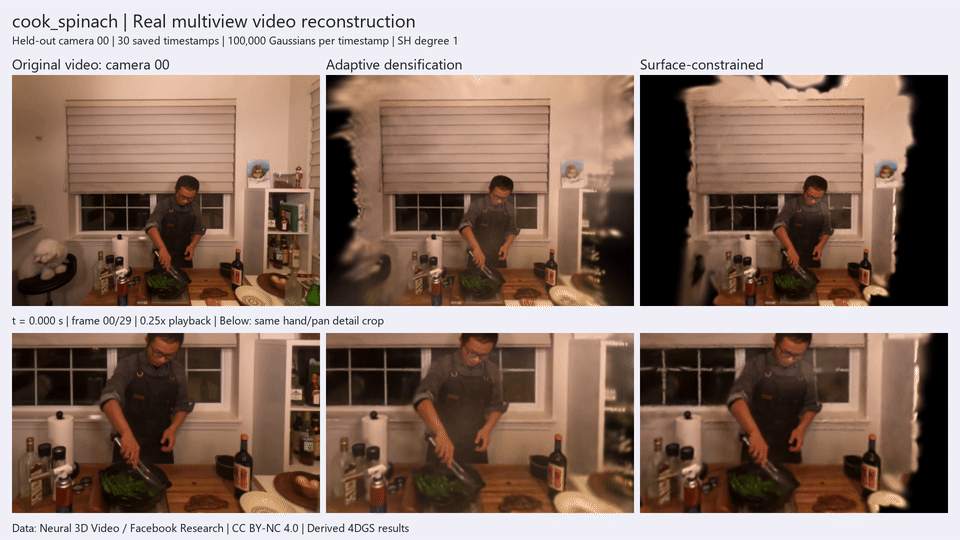

# 摄影测量引导的 4D Gaussian Splatting

[English](README.md) | [简体中文](README.zh-CN.md)

本项目提供面向 Spyder 的动态三维高斯训练、查看、渲染和评估代码。首页展示公开 Neural 3D Video 数据集 `cook_spinach` 的实际重建结果。仓库同时自带平移、形变两组受控实验的训练模型、输入图像、点云和网格参考。

[原始视频与重建对照](media/cook_spinach/cook_spinach_comparison.mp4) · [三维高斯旋转视频](media/cook_spinach/cook_spinach_3d.mp4) · [完整预览图](media/cook_spinach/poster.png)

## 公开数据结果

这里使用已下载的 [Neural 3D Video](https://github.com/facebookresearch/Neural_3D_Video/releases/tag/v1.0) 真实同步多相机 `cook_spinach` 数据。展示实验包含 30 个时刻，使用相机 01-20 的 600 张图像训练，相机 00 的 30 张图像用于保留视角评估。两个保存模型均训练 6,000 次迭代，使用一阶球谐函数，每个时刻包含 100,000 个活动高斯。

对照视频从左到右为原始图像、普通自适应增密、表面约束版本；下方放大相同的手部和锅具区域，并保留上方完整视野。三维视频分段展示时间播放、固定时刻下旋转相机、时间与相机同时变化。两者均来自保存的训练结果，来源和播放设置见 [公开结果说明](docs/PUBLIC_RESULTS.md)。

## 已实现功能

- 带局部速度、各向异性尺度和旋转的动态高斯模型。
- 自适应增密、原始来源编号追踪和表面支持约束。
- 曝光积分、时序图像监督，以及保留相机和保留时间的评估。
- 摄影测量证据引导的 Beta 不透明度参数。
- 带时间轴、播放暂停、旋转缩放、实验切换和色条的三维查看器。
- RGB、confidence `log(kappa)`、uncertainty `mu*(1-mu)/(kappa+1)` 三种显示，其中 `mu` 是不透明度均值，`kappa` 是 Beta 浓度。
- NPZ 模型、带属性的 PLY 时间序列、图像指标、网格距离和 confidence-error 统计导出。
- 三参数局部视差平面优化及数值验证。

## 在 Spyder 中使用

选择现有 **envtorch** 环境，打开 `view_pointclouds.py`，按 **F5**。默认显示 **cook_spinach 的表面约束三维结果**。在 **Experiment** 中切换 **Adaptive densification（普通增密）** 和 **Surface-constrained（表面约束）**；在 **Color** 中选择 **RGB、Confidence、Uncertainty**。拖动旋转，滚轮缩放，Ctrl 加拖动平移；使用时间轴或播放按钮查看时间变化，默认以 0.25 倍速播放。Confidence 和 Uncertainty 带色条，各序列的颜色范围在全部时刻保持一致。

查看器顶部的 `PUBLIC_PROJECT` 在本机会自动定位原公开数据工程；在其他机器上，将其设为包含 `benchmark_results/cook_spinach_30f_surface_v1/` 的工程目录。`DEFAULT_EXPERIMENT` 选择初始版本。查看器直接读取保存的逐帧 PLY 三维模型和原始时间戳。

查看仓库自带的受控实验时，打开 `view_controlled_results.py` 按 **F5**，可切换 **Translation（平移）** 和 **Deformation（形变）**。

所有入口均直接运行，不使用 argparse。路径相对于仓库文件解析，不依赖 Spyder 当前工作目录。

回归测试集中放在 `tests/`。在根目录的 `run_checks.py` 中按 F5 可执行全部测试，也可以直接打开任意 `tests/test_*.py` 按 F5 单独运行。两种方式都根据脚本位置定位项目模块和数据，无需手动切换工作目录。

| 文件 | 功能 |
|---|---|
| `view_controlled_results.py` | 查看两组三维序列并切换实验 |
| `view_pointclouds.py` | 默认查看 cook_spinach，并切换普通增密和表面约束版本 |
| `train_4dgs.py` | 默认执行 120 次迭代的快速训练 |
| `evaluate_results.py` | 重新渲染并评估两个保存模型的全部七个时刻 |
| `calibration_eval.py` | 导出图像 confidence/error 分析和图表 |
| `export_video.py` | 导出旋转展示 MP4、GIF、预览图和渲染记录 |
| `export_public_video.py` | 从本机公开数据实验重新生成对照和三维旋转视频 |
| `run_checks.py` | 执行回归测试并保存各项日志 |

在训练脚本中用 `EXPERIMENT="translation"` 或 `"deformation"` 选择实验；用 `PROFILE="full"` 运行保存的 3,000 次迭代配置。快速配置包含全部五个训练阶段和自适应分裂。新结果写入 `outputs/` 下的时间戳目录。

交互查看器可显示高斯椭球轮廓或中心。展示视频使用保存模型参数进行 CUDA 高斯透明度合成渲染，采用统一旋转相机和固定颜色范围。

重新生成公开数据视频时，`export_public_video.py` 中的 `PUBLIC_PROJECT` 指向包含已下载数据和 `cook_spinach_30f_surface_v1` 模型的原 `4D_GS` 工程；本机会自动找到该路径。两个成品视频和来源记录位于 `media/cook_spinach/`。

## 随附结果

[受控实验 RGB / confidence / uncertainty 视频](media/4dgs_sequence.mp4) · [受控实验预览](media/poster.png)

两组受控实验采用设计的纹理表面、米制相机几何和随机种子 1201。训练使用四个相机在帧 0、2、4、6 的 16 张图像。导出时间为 0.00 到 0.30 秒，间隔 0.05 秒。

| 指标 | 平移 | 形变 |
|---|---:|---:|
| 导出时刻数 |7|7|
| 每时刻有效/唯一高斯中心数 |12,000 / 12,000|12,000 / 12,000|
| 训练迭代数 |3,000|3,000|
| 球谐函数阶数 |0|0|
| 评估图像数 |22|22|
| 平均评估 PSNR |21.418 dB|21.402 dB|
| 保留时间的平均表面距离 |4.292 mm|4.227 mm|

PSNR 对 22 张评估图像取平均。表面距离为高斯中心到独立三角网格的无符号最近距离，在帧 1、3、5 汇总。原始数值保存在各结果目录的 `independent_evaluation/summary.json`，长度存储单位为米。视频以 24 fps 显示，每个保存时刻保持六个视频帧，共播放六轮。

## 环境与目录

本机验证环境为 Python 3.10、PyTorch 2.8.0/CUDA 12.9、Open3D 0.19.0、NumPy 2.2.6、SciPy 1.15.2、Spyder 6.0.8 和 RTX 4080 SUPER。三维 PLY 查看使用 Open3D，训练与模型渲染使用 CUDA rasterizer，视频导出使用 PATH 中的 FFmpeg。

现有 envtorch 可直接使用。新环境安装命令见 [英文 README](README.md#environment)。更换 Spyder 的 Python 解释器后重启其内核。

- `examples/data/`：训练输入、相机参数和评估参考。
- `examples/results/`：保存模型和三维 PLY 时间序列。
- `media/`：MP4、GIF 和预览图。
- `docs/`：数据格式、来源和验证记录。
- `tests/`：可单独运行的回归测试。
- `outputs/`：本地新生成结果，由 Git 忽略。

详见 [数据格式](docs/DATA.md)、[验证记录](docs/VALIDATION.md)、[来源记录](docs/source_manifest.json) 和 [第三方说明](THIRD_PARTY_NOTICES.md)。
